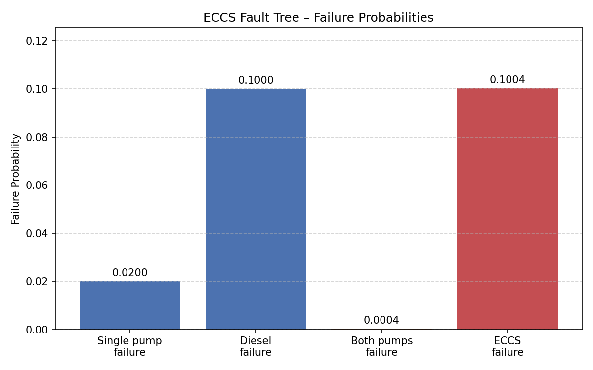

# PRA – Fault Tree Analysis of an ECCS in a PWR

[](https://github.com/DanieleCastrignano/pra-eccs-pwr/actions/workflows/tests.yml)

## 📌 Overview
Simplified Probabilistic Risk Assessment (PRA) of an Emergency Core Cooling System (ECCS) in a Pressurized Water Reactor (PWR). The system consists of two redundant injection pumps and one backup diesel generator. The analysis evaluates the probability of system failure using Fault Tree Analysis (FTA).

## 🎯 Objective
Quantify the failure probability of the ECCS under a simplified accident scenario, applying Boolean logic (AND/OR gates) and public reliability data.

## 🛠️ Tools
- Python 3.11
- matplotlib
- pytest
- Git / GitHub

## 📊 Methodology
- **AND gate**: both redundant pumps must fail.
- **OR gate**: system fails if both pumps fail OR the diesel generator fails.
- Reliability data sourced from public databases (IAEA, NUREG).

## 📈 Results

| Event | Probability |
|-------|-------------|
| Single pump failure | 0.02 |
| Diesel failure | 0.01 |
| Both pumps failure | 0.0004 |
| **ECCS failure** | **0.0021** |



## ⚙️ Installation

```bash
git clone https://github.com/DanieleCastrignano/pra-eccs-pwr.git
cd pra-eccs-pwr
pip install -r requirements.txt
